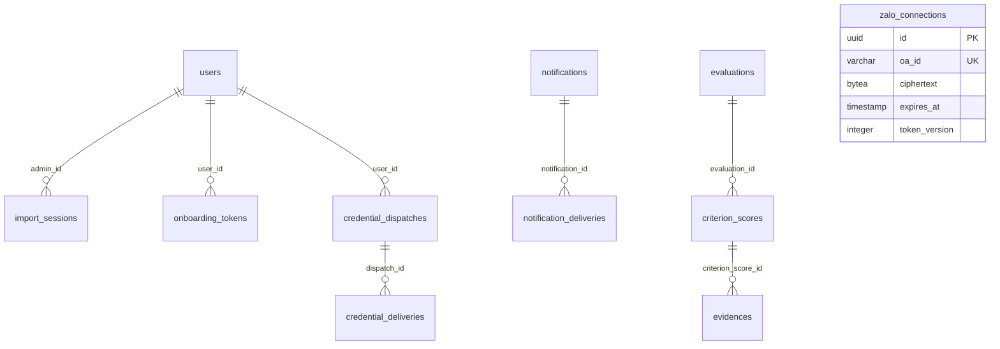

# VC03 — Bổ sung database

Nguồn triển khai là [schema Prisma](../be/prisma/schema.prisma) và [migration VC03](../be/prisma/migrations/20261112050000_vc03_database_foundation/migration.sql), chạy sau bốn migration VC00–VC02 theo thứ tự tên

Không thêm route/DTO/controller/FE trong chặng nền tảng này, [contract](API_CONTRACT.md#vc03--giao-ước-lưu-trữ-bổ-sung) ghi rõ mô hình lưu trữ nội bộ, không coi bảng mới là tính năng Import hoặc gửi tin đã hoàn thành

| Bảng/cột | Null/default/backfill | Khóa/index/TTL |
|---|---|---|
| ImportSession | rows/digest/admin/key/createdAt/expiresAt bắt buộc, PREVIEW mặc định, result/confirmedAt nullable đến khi CONFIRMED | unique admin/key, index status/expiresAt, FK admin NoAction, expiresAt > createdAt |
| OnboardingToken | user/version/hash bắt buộc, purpose PUSH_REGISTRATION, usedAt null lúc chưa dùng | hash unique SHA-256, index user/version và expiresAt, FK user NoAction, usedAt trong TTL |
| CredentialDispatch | ciphertext/nonce/tag/keyId bắt buộc, canceledAt nullable | unique user/version, index expiresAt, FK user NoAction, AES-GCM nonce 12/tag 16 byte |
| CredentialDelivery | PENDING, attemptCount 0, reason/error/message/provider/sentAt/nextAttempt/lease nullable | unique dispatch/channel, index status/nextAttempt và leaseUntil, FK dispatch NoAction |
| ZaloConnection | token mã hóa bắt buộc, tokenVersion 0, lease nullable | oaId unique, expiresAt > createdAt, không tạo dòng hoặc gọi provider khi migrate |
| NotificationDelivery lease/reasonCode | toàn bộ null cho dữ liệu cũ | CHECK lease đầy đủ, giữ nguyên status và dữ liệu TELEGRAM legacy |
| CriterionScore.supplementedAt | null cho dữ liệu cũ, không suy diễn từ updatedAt | trigger ghi khi nội dung tự chấm hoặc minh chứng bổ sung thực thay đổi |
| User.credentialVersion | giữ nguyên default/backfill 0 của VC02 | không tạo lại cột hoặc sửa user khi migrate VC03 |

Các bảng mới rỗng nên không cần backfill nghiệp vụ, không có FK cascade hoặc PostgreSQL enum mới, các trạng thái vẫn String + CHECK SQL

TTL không tự xóa dữ liệu: service/worker các chặng sau phải lọc hết hạn, kiểm version/canceledAt và tiêu thụ token bằng conditional update trong transaction

Rows import chỉ lưu dữ liệu allowlist đã chuẩn hóa, không chứa mật khẩu; nội dung ciphertext không được đưa vào audit hoặc response, thông điệp lỗi delivery phải lấy từ catalogue tiếng Việt của ứng dụng

Trigger giữ kiểm cùng kỳ, tiêu chí lá, điểm tối đa, reset điểm Admin khi selfScore đổi và append-only lịch sử, bổ sung cửa sổ DRAFT đã publish và `[selfEvalStart,selfEvalDeadline)`

Vòng bổ sung dùng `< supplementDeadline`, giá trị null bị từ chối, thời gian lấy `statement_timestamp() AT TIME ZONE 'UTC'` để transaction kéo dài không dùng thời điểm cũ từ `now()`

Thông điệp RAISE tiếng Việt, rule identifier ổn định ở trường CONSTRAINT, SQLSTATE 23514 được filter ánh xạ thành DB_RULE_VIOLATION; không dùng câu SQL/provider làm thông báo API

Seed dựng fixture trong cửa sổ tạm hợp lệ cùng transaction rồi khôi phục lịch mẫu, không tắt trigger, không mở lịch tạm ra ngoài transaction

Chạy `node --import tsx scripts/verify-vc03.mjs` từ thư mục backend với DATABASE_URL local, script tạo DB tên UUID mới, giữ DB để đối chiếu, không reset/xóa DB có sẵn và không gửi provider

Script kiểm migrate DB trống, seed, upgrade từ VC02 có user, trigger/constraint/UTC, lỗi Prisma model/raw thật và regression Auth; chỉ tên DB được in, không in URL hay credential

Rollout DB dùng chung chưa được thực hiện, cần sao lưu và chọn môi trường trước khi chạy migrate deploy; các dịch vụ Import/onboarding/dispatcher/Zalo thuộc chặng sau
